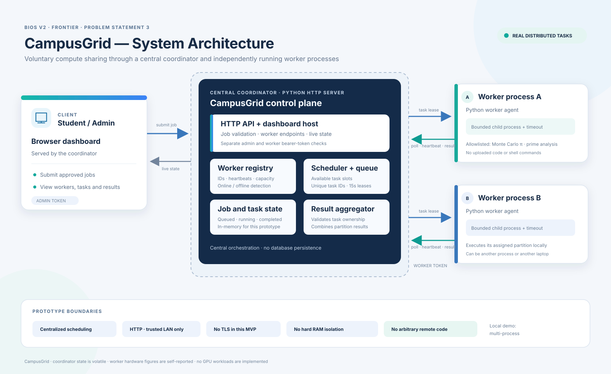

# CampusGrid

**Turn idle campus computers into a shared computing resource.** CampusGrid is a voluntary coordinator-worker prototype for distributing allowlisted CPU jobs across independent Python processes and computers on a trusted private LAN.

## Architecture



The coordinator serves the dashboard and API, tracks worker registration and heartbeats, leases allowlisted task partitions to independent worker processes, and aggregates their results. Workers poll for work, execute bounded built-in computations, and return results over the trusted LAN.

## What works

- Workers register a random generated ID, chosen display name, CPU count, available RAM estimate, task slots, heartbeat, and completed-task count. No hostname is collected by default.
- The coordinator partitions Monte Carlo π and prime-counting jobs and leases tasks to workers with available capacity.
- Workers execute built-in functions only. The API accepts no source code, shell commands, file paths, or uploaded executables.
- Results are checked against task ownership and aggregated by the coordinator. Duplicate and late results are rejected.
- Stale workers are marked offline; expired leases return unfinished tasks to the queue.
- The browser dashboard reads live coordinator state and can submit jobs with the separate admin token.
- `scripts/integration_demo.py` launches one coordinator and two independent worker OS processes, runs a 12-partition Monte Carlo job, and asserts participation from both.

The MVP uses centralized orchestration, not fully decentralized peer-to-peer scheduling. It is a demonstration, not a production compute cluster.

## Requirements

- Python 3.11 or newer
- No required third-party packages; `psutil` is optional for RAM reporting. Without it, a platform estimate or 4 GB fallback is shown.
- No internet, GPU, Docker, cloud account, or external database required after obtaining Python.

## Run on Windows

Open three PowerShell windows in the `campusgrid` directory.

### 1. Install and configure

```powershell
py -3 -m venv .venv
.\.venv\Scripts\Activate.ps1
python -m pip install -r requirements.txt
$env:CAMPUSGRID_WORKER_TOKEN = "replace-with-a-long-random-worker-secret"
$env:CAMPUSGRID_ADMIN_TOKEN = "replace-with-a-different-long-random-admin-secret"
```

PowerShell may block activation scripts. If so, run `.venv\Scripts\python.exe` in place of `python` for all commands; no policy change is needed.

### 2. Start coordinator

```powershell
python -m coordinator.main
```

Open `http://127.0.0.1:8000` for the dashboard and `http://127.0.0.1:8000/api/health` for the health endpoint.

### 3. Start worker A

In another PowerShell window, activate the same environment and set the same worker token:

```powershell
$env:CAMPUSGRID_WORKER_TOKEN = "replace-with-a-long-random-worker-secret"
python -m worker.worker --server http://127.0.0.1:8000 --name Laptop-A --worker-id laptop-a
```

### 4. Start worker B

In a third PowerShell window:

```powershell
$env:CAMPUSGRID_WORKER_TOKEN = "replace-with-a-long-random-worker-secret"
python -m worker.worker --server http://127.0.0.1:8000 --name Laptop-B --worker-id laptop-b
```

### 5. Submit a computation

Enter the admin token in the dashboard. Select Monte Carlo π, set 1,000,000 samples and 8 partitions, then submit. Watch task progress and each worker's contributions update live.

Prime analysis is also available. Its range is 1 through the configured upper limit.

## Multi-machine trusted LAN setup

On the coordinator laptop, find its private IPv4 address with:

```powershell
ipconfig
```

Start the coordinator bound to the LAN interface:

```powershell
$env:CAMPUSGRID_HOST = "0.0.0.0"
$env:CAMPUSGRID_PORT = "8000"
$env:CAMPUSGRID_WORKER_TOKEN = "same-long-worker-secret-on-all-nodes"
$env:CAMPUSGRID_ADMIN_TOKEN = "separate-long-admin-secret"
python -m coordinator.main
```

Allow only the coordinator port from the local subnet in an elevated PowerShell session, if Windows Firewall blocks inbound traffic:

```powershell
New-NetFirewallRule -DisplayName "CampusGrid trusted LAN" -Direction Inbound -Action Allow -Protocol TCP -LocalPort 8000 -RemoteAddress LocalSubnet
```

From another laptop on the same trusted network, check reachability and join:

```powershell
Test-NetConnection 192.168.1.10 -Port 8000
$env:CAMPUSGRID_WORKER_TOKEN = "same-long-worker-secret-on-all-nodes"
python -m worker.worker --server http://192.168.1.10:8000 --name Teammate-Laptop
```

Replace `192.168.1.10` with the coordinator's actual IPv4 address. Use the dashboard on `http://192.168.1.10:8000`. The setup sends credentials over plain HTTP and is for a trusted demonstration LAN only. Do not port-forward or expose it to the public internet. Use HTTPS or a secure tunnel before any untrusted network use. Remove the firewall rule after the demo with `Remove-NetFirewallRule -DisplayName "CampusGrid trusted LAN"`.

## API quick reference

- `GET /api/health`, `GET /api/state`
- `POST /api/workers/register` and `POST /api/workers/{id}/heartbeat` (worker token)
- `GET /api/workers/{id}/task` (worker token)
- `POST /api/tasks/{id}/result` and `/failure` (worker token)
- `POST /api/jobs` (admin token); `GET /api/jobs/{id}`

Credentials use `X-Worker-Token` and `X-Admin-Token`. Job types are `monte_carlo_pi` and `prime_analysis`. Parameter limits are enforced server-side. Dashboard refreshes from `/api/state` every 1.3 seconds.

## Tests

```powershell
python -m unittest discover -s tests -v
python scripts/integration_demo.py
```

The integration demo starts independent coordinator and worker processes on localhost. This proves multi-process distribution, not separate physical machines or LAN reachability. The integration output records the result and participating worker IDs.

## Limitations

- Coordinator state is in memory and is lost on restart; SQLite persistence is not part of this MVP.
- Worker-reported hardware metadata is informational and not independently verified.
- Shared bearer tokens are not per-worker credentials; use only in a trusted demo network.
- There is no TLS, strict CPU/RAM quota enforcement, process sandbox, GPU execution, or production-grade authorization. Task inputs are bounded, functions are allowlisted, and there is no remote code execution path.
- A task lease is finite; exceptionally slow tasks can be retried. The shipped workloads are intentionally bounded.
- Performance varies by machine and network. Distributed overhead can exceed compute savings for small jobs.
